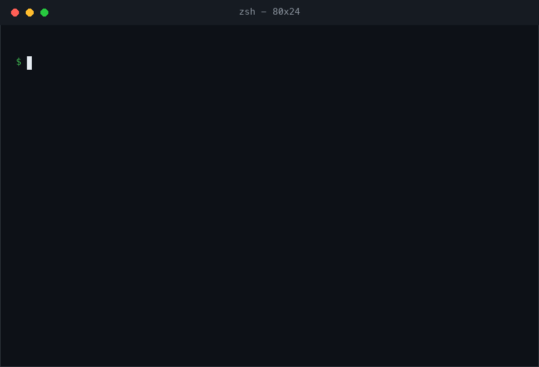

```
                 _ _            _
  __ _ ___  ___(_|_) __ _ _ __| |_
 / _` / __|/ __| | |/ _` | '__| __|
| (_| \__ \ (__| | | (_| | |  | |_
 \__,_|___/\___|_|_|\__,_|_|   \__|
```

A small, boring tool that does two things well: **images to terminal art** and
**text to FIGlet banners**. One command, zero dependencies for text, no
compiled helpers, no configuration file.



## What you get

- **`asciiart text`** — a native FIGfont engine. Full-width, kerning and
  controlled/universal smushing, all six smushing rules, word wrapping,
  German umlauts, code-tagged glyphs — implemented from the FIGfont 2.0
  specification, matching the reference C implementation.
- **25 classic FIGlet fonts bundled** — Standard, Slant, Doom, Star Wars,
  Isometric, Big, Banner, Shadow, Mini and more. If you already have figlet
  or pyfiglet installed, their fonts are discovered and used automatically.
- **`asciiart image`** — three renderers:
  - character ramps (5 named ramps or your own),
  - ANSI half-blocks (`▀` with 24-bit or 8-bit foreground/background) for
    double vertical resolution and full color,
  - Unicode braille (2×4 dots per cell) for high-detail line art, with
    optional Floyd–Steinberg dithering.
- Tone controls that actually matter for ASCII: brightness, contrast, gamma,
  auto-levels, invert.
- Sane terminal behavior: width defaults to the terminal, colors are
  disabled when piped, `NO_COLOR` is respected.

## Quick start

No installation needed, run it straight from a checkout:

```sh
bin/asciiart text "hello" -f slant     # or: python3 -m asciiart text "hello" -f slant
```

Or install it as a command (text engine still dependency-free; image
conversion uses Pillow if present):

```sh
pipx install .                # recommended
pip install .                 # fine too
python3 -m pip install ".[image]"   # pulls in Pillow
```

## Text to FIGlet

```sh
asciiart text "asciiart" -f standard
```

```
                 _ _            _
  __ _ ___  ___(_|_) __ _ _ __| |_
 / _` / __|/ __| | |/ _` | '__| __|
| (_| \__ \ (__| | | (_| | |  | |_
 \__,_|___/\___|_|_|\__,_|_|   \__|
```

```sh
asciiart text "Terminals" -f doom
```

```
 _____                   _             _
|_   _|                 (_)           | |
  | | ___ _ __ _ __ ___  _ _ __   __ _| |___
  | |/ _ \ '__| '_ ` _ \| | '_ \ / _` | / __|
  | |  __/ |  | | | | | | | | | | (_| | \__ \
  \_/\___|_|  |_| |_| |_|_|_| |_|\__,_|_|___/
```

Let the tool pick, wrap at a width, or read from stdin:

```sh
asciiart text "any figlet font" --random
asciiart text "a longer headline" -w 60 -j center
echo "zero deps" | asciiart text - -f mini
```

```
$ echo "zero deps" | asciiart text - -f mini

_  _ .__   _| _ ._  _
/_(/_|(_) (_|(/_|_)_>
                |
```

### Fonts

```sh
asciiart fonts          # list everything discoverable
asciiart fonts -v       # with paths and sources
```

```
Alligator    7 rows  bundled
Avatar       6 rows  bundled
Banner       8 rows  bundled
Big          8 rows  bundled
Block        8 rows  bundled
Bubble       4 rows  bundled
...
```

Fonts are looked up in this order — existing installations always win over
the bundled pack:

1. `$ASCIIART_FONTPATH` (colon-separated directories)
2. `~/.asciiart/fonts/`
3. an installed **pyfiglet** package (`pyfiglet/fonts/`)
4. a system **figlet** installation (queried via `figlet -I2`)
5. common system paths (`/usr/share/figlet`, `/opt/homebrew/share/figlet`, …)
6. the 25 fonts bundled with this package

Drop any `.flf` file into one of those directories and it becomes available
by name, case-insensitively, with typo suggestions:

```
$ asciiart text hi -f standrd
asciiart: error: unknown font 'standrd'; did you mean: standard?
```

## Images to terminal art

```sh
asciiart image examples/valley.png -w 76 --auto-levels
```

```
                              .         .
............................................................................
::::::::::::::::::::::::::::::::::::::::::::::::::::.   .:::::::::::::::::::
:--:::--:--::::::-----::-:::---::---:--:::::----::-:+@@@@::::::-:::----:--::
---------------------------------------------------*@@@@@@:=----------------
===================================================+@@@@@@-=================
+++++++++++++++++++++++++++++++++++++++++++++++++++==%@@+=++++++++++++++++++
****************************************************##********************
############################################################################
@%@@@@@%%%%@@%%%@%%%%%%%%@@@@%%%%%%@@@@%%%%%%%%%%%%%%%@@@@@@@%%%%%@%%%%%%%%%
@@@%%####**#%@@@@@@@@@@@@@%%#########%@@@@@@@@@@@@@@@@%%%%###*****#@@@@@@@@@
#*****++=+***#%@@@@@@@@%#**************#@@@@@@@@%%##****************#@@@@@@%
*+=-----------=++******+++==--+*****************************************#%*-
=----------------====-----------+****#*****++=================+++++*****+---
---------------------------------=+*+-..::-----------..--------------===----
----------------------------------:..     ..:------..  ..:------------------
....:::-----::::::::::::.......................   ..    ..  ..--------:..  .
                                                 .::::::::.
```

Full-color half-blocks (fg = upper pixel, bg = lower pixel, so every
terminal row shows two pixel rows):

```sh
asciiart image examples/valley.png -w 100 --format blocks --color 24bit
```

Braille — 2×4 dots per cell, ideal for logos, glyphs and line art:

```sh
asciiart image examples/digits.png -w 50 --format braille --threshold 0.45
```

```
⠀⠀⠀⠀⠀⠀⢀⣀⣀⠀⠀⠀⠀⠀⠀⠀⣀⣠⣤⣄⣀⠀⠀⠀⠀
⠀⠀⠀⠀⠀⣰⣿⣿⣿⠇⠀⠀⠀⠀⣴⣿⣿⣿⣿⣿⣿⣷⣄⠀⠀
⠀⠀⠀⠀⣰⣿⣿⣿⠏⠀⠀⠀⠀⣸⣿⣿⣿⠛⠙⠻⣿⣿⣿⡆⠀
⠀⠀⠀⣰⣿⣿⣿⣯⣤⣤⣄⠀⠀⠹⠿⠿⠟⠀⠀⣠⣿⣿⣿⡇⠀
⠀⠀⣰⣿⣿⣿⠏⢸⣿⣿⣿⠀⠀⠀⠀⠀⠀⢀⣴⣿⣿⣿⠟⠀⠀
⠀⢰⣿⣿⣿⣿⣤⣾⣿⣿⣿⣤⣄⠀⠀⠀⣠⣿⣿⣿⡿⠋⠀⠀⠀
⠀⢿⣿⣿⣿⣿⣿⣿⣿⣿⣿⣿⣿⠀⣠⣾⣿⣿⣿⣋⣀⣀⣀⠀⠀
⠀⠀⠉⠉⠉⠉⠉⢹⣿⣿⣿⠉⠀⢰⣿⣿⣿⣿⣿⣿⣿⣿⣿⣷⠀
⠀⠀⠀⠀⠀⠀⠀⠘⠿⠿⠋⠀⠀⠘⠿⠿⠿⠿⠿⠿⠿⠿⠿⠋⠀
```

Read from stdin, tune tone, use your own ramp:

```sh
asciiart image scan.tiff -w 120 --gamma 1.6 --contrast 1.2
asciiart image logo.png --format ascii --charset " .:-=+*#%@"
curl -s https://example.com/cat.png | asciiart image - -w 80
```

### Character ramps

| name       | ramp                                | character of the output        |
| ---------- | ----------------------------------- | ------------------------------ |
| `standard` | ` .:-=+*#%@`                        | the everyday default           |
| `detailed` | 69 characters                       | photographs, gradients         |
| `blocks`   | ` ░▒▓█`                             | chunky, poster-like            |
| `contrast` | ` .:*#@`                            | bold, high-contrast shapes     |
| `minimal`  | ` .:#`                              | thumbnails, quick previews     |

Any other string is used as a custom ramp, ordered dark to light.

### Why `--aspect` defaults differ per format

A terminal cell is about twice as tall as it is wide. Plain ASCII maps one
pixel to one cell, so it needs a 0.5 row-per-column correction. Half-blocks
already stack two pixel rows per cell, and braille packs 2×4 pixels per
cell — for those, the correct default is 1.0. The CLI picks the right
default per `--format`; override with `--aspect` if your font renders
cells differently.

## As a library

```python
from asciiart import render_text, image_to_ascii, list_fonts

print(render_text("hello", font="slant"))
print(len(list_fonts()), "fonts available")

art = image_to_ascii("photo.jpg", width=100, charset="detailed")  # needs Pillow
```

The engine (`asciiart.figlet.FigFont`) exposes layout overrides (`smushmode`
parameter), justification, print direction and per-glyph access, in case you
want to build on it.

## Development

```sh
python3 -m unittest discover -s tests    # 77 tests, no dependencies needed
python3 -m asciiart demo                 # a tour of fonts, ramps, renderers
```

Repository layout:

```
asciiart/          the package (figlet engine, renderers, CLI)
  fonts/           25 bundled .flf fonts (original headers retained)
bin/asciiart       run from a checkout without installing
tests/             unittest suite
tools/             make_examples.py, make_gif.py (regenerate repo assets)
examples/          sample images used by the README and the demo GIF
demo/demo.gif      the demo recording (regenerate with tools/make_gif.py)
```

## Licenses

Code: MIT, see [LICENSE](LICENSE).

Fonts: each bundled `.flf` file retains its original author and license
header (the standard FIGlet font notice — free to use and distribute with
the notice preserved). The bundled set is the classic collection from the
[figlet-fonts](https://github.com/xero/figlet-fonts) archive.
